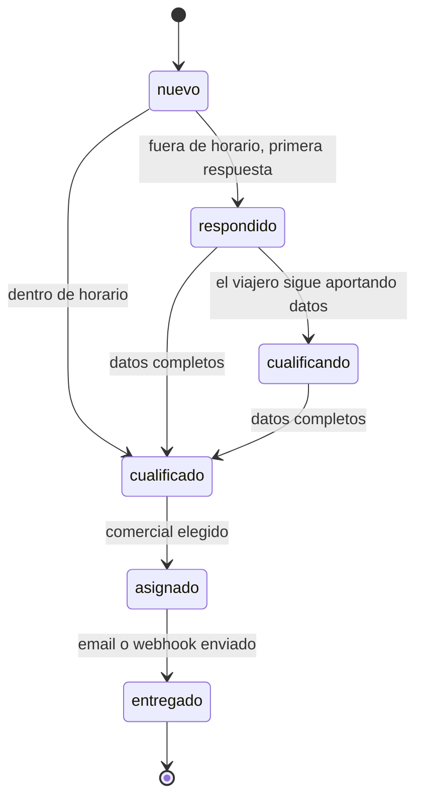
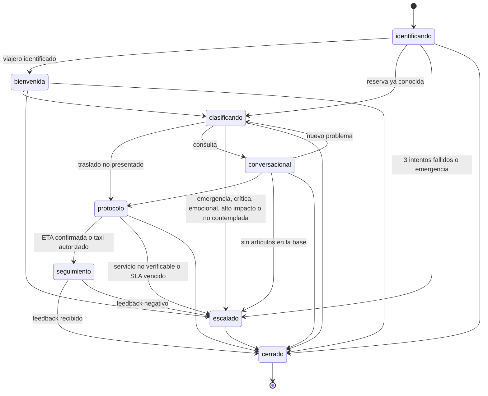

# 01 · Documentación técnica

Requisitos del sistema tal como están implementados en `bextia-agentes/`. Cada requisito indica el módulo que lo cumple (rutas relativas a `bextia-agentes/`). Lo que el alcance pide y el prototipo no cubre figura como pendiente, con remisión a [09 · Limitaciones](./09-limitaciones.md) o [12 · Riesgos](./12-riesgos.md).

## Alcance

- **Agente 1 · Leads fuera de horario** (completo): responde, cualifica, puntúa, asigna y entrega el lead al comercial.
- **Agente 2 · Incidencias en viaje** (prototipo): identifica al viajero, clasifica, resuelve el **traslado no presentado** con un protocolo declarativo, responde consultas con la base de conocimiento y escala el resto a la guardia humana.
- Fuera de alcance: canal de voz/teléfono, app móvil, mensajes proactivos durante el viaje (la bienvenida solo existe cuando el viajero escribe primero), cierre de ventas por IA e integración nativa con el CRM.

## Ruteo común

Todo mensaje entra por el gateway y el orquestador decide qué agente lo atiende (`apps/agents/src/orchestrator/route.ts`), en este orden:

1. Hay una incidencia abierta en la conversación → Agente 2.
2. El remitente es el proveedor de un traslado de los últimos 7 días → Agente 2 (respuesta del proveedor).
3. El contacto tiene una reserva activa → Agente 2.
4. El texto contiene un código de reserva (patrón `AB-1234`) → Agente 2.
5. En cualquier otro caso → Agente 1.

## Requisitos funcionales · Agente 1 (leads)

| ID | Requisito | Implementación |
|---|---|---|
| RF-A1-01 | **Canales.** Recibe leads por WhatsApp Cloud API, email (webhook entrante con secreto), formulario (webhook con secreto), widget web (con OTP por email o WhatsApp, válido 10 minutos) y simulador. Cada canal se activa solo si sus variables de entorno están completas. | `apps/agents/src/channels/whatsapp.ts`, `channels/json-channel.ts`, `channels/web.ts`, `widget/otp.ts`, `widget/token.ts`, `main.ts` |
| RF-A1-02 | **Horario comercial.** Evalúa el horario semanal del mercado del lead con su zona horaria y festivos (`business_hours`). Si el mercado no tiene horario configurado, se considera fuera de horario. | `apps/agents/src/orchestrator/business-hours.ts`, `orchestrator/route.ts` |
| RF-A1-03 | **Respuesta fuera de horario.** Fuera de horario conversa con el viajero (Claude Sonnet) apoyándose en la base de conocimiento y pide los datos que faltan. Dentro de horario no conversa: registra, cualifica, asigna y notifica al comercial al momento. | `apps/agents/src/leads/agent.ts`, `leads/prompts.ts` |
| RF-A1-04 | **Cualificación.** Extrae 12 campos de la conversación con Claude Haiku y salida JSON validada: destino, fechas de inicio y fin, viajeros, interés, urgencia, tipo, idioma, nombre, email, teléfono y pregunta. | `apps/agents/src/leads/qualify.ts` (`extractQualification`, `QUALIFICATION_SCHEMA`) |
| RF-A1-05 | **Scoring.** Puntuación determinista de 0 a 100: completitud 60, urgencia 15, proximidad del viaje 15, grupo (6 o más viajeros) 5 y tipo de lead 5. Los pesos se ajustan con `SCORING_RULES_JSON`. | `apps/agents/src/leads/scoring.ts` (`DEFAULT_SCORING`, `scoreLead`) |
| RF-A1-06 | **Asignación.** Elige el comercial activo con mejor coincidencia: destino 4 puntos, idioma 2, mercado 2 y tipo 1. Desempata por la menor carga de leads en estado `asignado`. | `apps/agents/src/leads/assign.ts` |
| RF-A1-07 | **Resumen IA.** Genera un resumen del lead para el comercial con Claude Haiku. Los datos estructurados se envían sin nombre, email ni teléfono, pero la transcripción va sin redactar (pendiente: ver P35/P40 en [09](./09-limitaciones.md) y [12](./12-riesgos.md)). | `apps/agents/src/leads/qualify.ts` (`summarizeLead`) |
| RF-A1-08 | **Entrega.** Envía un email al comercial dentro de su horario (por omisión, lunes a viernes de 8 a 19 en Europe/Madrid), deja el lead en la bandeja del backoffice y, si está configurado, lo envía a un webhook firmado (`x-bextia-signature`, HMAC SHA-256). Los leads fuera de horario sin actividad durante 2 horas se promueven a entrega. | `apps/agents/src/leads/delivery.ts` (`deliverDue`, `notifyNow`), `notify/mailer.ts` |
| RF-A1-09 | **Mensajes no soportados y fallos del LLM.** Ante un adjunto o mensaje no textual responde con un texto fijo. Si el LLM falla, envía una respuesta de respaldo y marca el lead con `requiere_humano`. | `apps/agents/src/leads/agent.ts` (`UNSUPPORTED_REPLY`, `FALLBACK_REPLY`) |

### Ciclo del lead

Transiciones permitidas en `apps/agents/src/leads/store.ts`.

## Requisitos funcionales · Agente 2 (incidencias)

| ID | Requisito | Implementación |
|---|---|---|
| RF-A2-01 | **Identificación.** Vincula al viajero con una reserva activa por teléfono, email o código de reserva y confirma su identidad por el apellido del titular, con un máximo de 3 intentos; después escala. | `apps/agents/src/incidents/agent.ts` (`surnameMatches`), `orchestrator/route.ts` |
| RF-A2-02 | **Bienvenida.** En el primer contacto del viaje envía un mensaje de bienvenida, una sola vez por reserva (`booking.bienvenida_at`). Solo ocurre cuando el viajero escribe primero: no hay mensajes proactivos. | `apps/agents/src/incidents/agent.ts`, `incidents/prompts.ts` (`welcomeMessage`) |
| RF-A2-03 | **Emergencias.** Antes de llamar al LLM, una detección por palabras clave responde con el texto de emergencia (112) y escala con urgencia crítica. | `apps/agents/src/incidents/classify.ts` (`detectEmergency`), `incidents/prompts.ts` (`EMERGENCY_REPLY`) |
| RF-A2-04 | **Clasificación.** Claude Haiku clasifica tipología (`traslado_no_presentado`, `consulta`, `emergencia`, `otra`), urgencia (`baja`, `media`, `alta`, `critica`), carga emocional, impacto económico alto, idioma y un resumen, sobre el historial redactado. Una regla determinista (`decideRoute`) decide la ruta. | `apps/agents/src/incidents/classify.ts` (`classifyIncident`, `decideRoute`) |
| RF-A2-05 | **Protocolo de traslado no presentado.** Verifica el servicio en la reserva, contacta al proveedor (simulador, WhatsApp o email), avisa al viajero, espera la ETA 15 minutos (aceptada si es de 30 minutos o menos) y, si no hay respuesta a tiempo, el proveedor rechaza o la ETA supera los 30 minutos, autoriza un taxi hasta el tope configurado; confirma al viajero y pide feedback. | `apps/agents/src/protocols/definitions/traslado-no-presentado.json`, `protocols/engine.ts`, `incidents/runner.ts`, `incidents/provider.ts` |
| RF-A2-06 | **Guardarraíl de gasto.** El monto autorizado debe ser mayor que 0 y no superar el tope del protocolo; el LLM no fija montos. Los reembolsos manuales acumulados no superan lo autorizado. | `apps/agents/src/incidents/runner.ts` (`isAuthorizableAmount`), `api/incidents.ts` |
| RF-A2-07 | **Respuesta con base de conocimiento (RAG).** Las consultas se responden con Claude Sonnet y los 3 artículos más similares del idioma del viajero (similitud mínima 0,78). Sin artículos relevantes, escala con motivo `sin_kb`. | `apps/agents/src/rag/kb.ts`, `incidents/agent.ts`, `incidents/prompts.ts` (`buildIncidentSystem`) |
| RF-A2-08 | **Escalado.** Escalan las emergencias, las urgencias críticas, los casos emocionales o de alto impacto económico, las tipologías no contempladas, la identificación fallida y el vencimiento de SLA. Se notifica por email a la persona de guardia activa con menor prioridad, con enlace a `/incidencias/:id`. | `apps/agents/src/incidents/escalate.ts`, `incidents/classify.ts`, `incidents/sla.ts` |
| RF-A2-09 | **SLA.** Plazos por urgencia: crítica 10 minutos, alta 30, media 60 y baja 240. Las incidencias en `clasificando` o `protocolo` con SLA vencido se escalan solas. | `apps/agents/src/incidents/store.ts` (`SLA_MINUTES`), `incidents/sla.ts` (`escalateOverdue`) |
| RF-A2-10 | **Cierre con feedback.** En `seguimiento`, la respuesta del viajero cierra la incidencia y queda como feedback; si es negativa, escala. Las incidencias sin actividad durante 24 horas se cierran. | `apps/agents/src/incidents/agent.ts`, `incidents/prompts.ts` (`isNegativeFeedback`), `incidents/sla.ts` (`closeStale`) |
| RF-A2-11 | **Trazabilidad.** Cada acción (mensaje, espera, decisión, autorización, escalado, resultado) queda en `incident_action`. | `apps/agents/src/incidents/store.ts`, `incidents/runner.ts` |

### Ciclo de la incidencia

Transiciones permitidas (`TRANSITIONS` en `apps/agents/src/incidents/store.ts`). Desde cualquier estado abierto, el operador puede cerrar la incidencia a mano.

## Requisitos no funcionales

| ID | Requisito | Implementación y estado |
|---|---|---|
| RNF-01 | **Primera respuesta en menos de 30 segundos.** | El webhook responde de inmediato y el agente trabaja en segundo plano, con la cola serializada por conversación (`apps/agents/src/server/pipeline.ts`). Cada llamada a Claude tiene un timeout de 20 s y 2 reintentos (`main.ts`); en el peor caso la suma supera los 30 s. La latencia real queda en el KPI `respuesta_enviada` (milisegundos desde la recepción). El indicador «1.ª respuesta (p50)» del panel lee eventos `first_response`, que ningún agente emite, así que hoy muestra «sin datos» (`apps/backoffice/src/lib/kpi.ts`; pendiente P73, ver [09](./09-limitaciones.md)). |
| RNF-02 | **Idempotencia.** Un mensaje repetido por el canal no se procesa dos veces. | Índice único `message_canal_external_id` sobre (canal, external_id) e inserción con `onConflictDoNothing` (`apps/agents/src/gateway/ingest.ts`); el pipeline descarta el duplicado. Una sola conversación abierta por contacto y canal (`conversation_abierta_unica`) y una incidencia abierta por conversación (`incident_abierta_por_conversacion`). |
| RNF-03 | **Rate limiting.** | 20 mensajes cada 60 s por contacto y 120 peticiones cada 60 s por IP (`apps/agents/src/server/rate-limit.ts`, `main.ts`). El contador vive en memoria: vale para una sola instancia (P2). |
| RNF-04 | **RGPD y datos personales.** | Parcial. Implementado: secretos solo en variables de entorno, RLS por rol (`supabase/rls/0001_rls.sql`), redacción de nombre, email, teléfono, código de reserva, proveedor y referencia antes del LLM en el Agente 2 (`apps/agents/src/incidents/redact.ts`). Pendiente: minimización en el Agente 1 (P35/P40) y purga por retención o derecho de supresión (P57). Ver [09](./09-limitaciones.md) y [12](./12-riesgos.md). |
| RNF-05 | **Firma de webhooks.** | WhatsApp valida `X-Hub-Signature-256` con `WHATSAPP_APP_SECRET` (`channels/whatsapp.ts`); email y formulario validan `x-webhook-secret` (`channels/json-channel.ts`). Comparación en tiempo constante (`channels/errors.ts`). |
| RNF-06 | **Resiliencia ante fallos del LLM.** | Sin `ANTHROPIC_API_KEY` el sistema arranca con un LLM no disponible que fuerza respuestas de respaldo (`llm/unavailable.ts`). Las salidas JSON se validan con Clark (`llm/anthropic.ts`) y, si no validan, el caso pasa a humano. |
| RNF-07 | **Control de acceso.** | JWT de Supabase verificado por JWKS con el rol en `app_metadata.role`, limitado a `admin`, `comercial` y `operador` (`apps/agents/src/auth/jwt.ts`, `auth/roles.ts`). |
| RNF-08 | **Una sola instancia.** | Temporizadores, límites de tasa y serialización por conversación viven en el proceso. Escalar a varias instancias exige un lock en Postgres o un cron externo (P2, P17, P21, P32). |
