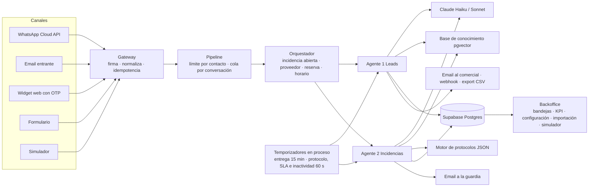

# 02 · Propuesta técnica

Arquitectura y criterios de operación de la plataforma de agentes de BEXTIA, actualizados a lo construido en `bextia-agentes/`. Los costos de desarrollo y de operación están en la [propuesta económica (1b)](../propuesta/1b-propuesta-economica.md).

## Decisiones

| Tema | Decisión | Por qué |
|---|---|---|
| Cloud | Render (un servicio web para la API y un sitio estático para el backoffice) y Supabase (Postgres, pgvector, Auth y una Edge Function de embeddings). | Dos proveedores gestionados cubren todo; no hay servidores que mantener y el despliegue se describe en un único `render.yaml`. Supabase concentra datos, búsqueda vectorial y autenticación en un solo contrato. |
| Tareas programadas | Temporizadores dentro del proceso (`setInterval`), sin cron de Render. | Con una sola instancia es lo más barato y simple: no hay servicio adicional ni cola. Al escalar se migra a cron o a un lock en Postgres (P17, P32). |
| Motor de agentes | API Node 24 con TypeScript y Hono. Cada agente es una máquina de estados explícita que usa Claude solo para interpretar lenguaje: clasificación con salida JSON validada y conversación de texto libre. No se usa tool use: las acciones las decide el código. | Las transiciones, topes y escalados son deterministas y se prueban sin LLM. El modelo no puede ejecutar acciones ni cambiar montos. |
| Contrato de datos | Esquema declarado en `contract/jor.json` y API base generada con Jor-El en `api/` (esquema Drizzle en `api/src/db/schema.ts`). | Un solo origen para tablas y tipos; el agente reexporta el mismo esquema. |
| Modelos | Claude Haiku 5.5 (`claude-haiku-5-5`) para clasificar y extraer; Claude Sonnet 5.5 (`claude-sonnet-5-5`) para conversar. | Ver [Modelos](#modelos). |
| Canales | Interfaz única de canal con adaptadores: WhatsApp Cloud API, email entrante (webhook) y saliente (SMTP), formulario, widget web y simulador. | Añadir un canal no toca los agentes. El simulador usa la misma interfaz, así las pruebas recorren el camino real. |
| Email saliente | SMTP personalizado (por ejemplo Resend o Brevo), el mismo que se configura en Supabase Auth, usado por la API con nodemailer. | Un único proveedor de correo para login y notificaciones. |
| Integración sin CRM | Entrada: CSV de reservas desde el backoffice, `POST /import/bookings` y `POST /import/email`. Salida: email al comercial, bandeja del backoffice, export CSV y webhook firmado opcional. | No hay credenciales del CRM del cliente; los formatos abiertos permiten integrar después sin rehacer nada. |
| Tipología del Agente 2 | Traslado no presentado, como protocolo JSON declarativo. | Es la incidencia más frecuente y acotada; deja probado el motor para añadir tipologías como datos. |
| Base de conocimiento | Embeddings gte-small (384 dimensiones) generados por la Edge Function `embed` de Supabase; búsqueda con pgvector. | Sin proveedor de embeddings de pago y sin que los textos salgan de Supabase (decisión P3). |
| UI | Backoffice con Lara Fluent (React 19 y Fluent UI 9), arquetipo backoffice. | Componentes ya resueltos para bandejas, CRUD y KPI. |
| Gestor de paquetes | yarn 1 con un solo `yarn.lock`. | Render compila con yarn por omisión. |

## Arquitectura lógica

Unidades y su código (detalle en [05 · Código y componentes](./05-codigo-y-componentes.md)):

- `apps/agents/src/channels/` y `gateway/`: adaptadores de canal e ingesta idempotente.
- `apps/agents/src/server/`: aplicación Hono, pipeline, límites de tasa y temporizadores.
- `apps/agents/src/orchestrator/`: ruteo entre agentes y horario comercial.
- `apps/agents/src/leads/` y `incidents/`: los dos agentes.
- `apps/agents/src/protocols/`: intérprete de protocolos JSON.
- `apps/agents/src/rag/`, `llm/` y `notify/`: base de conocimiento, cliente de Claude y SMTP.
- `apps/backoffice/`: panel de operación.

## Modelos

| Uso | Modelo | Dónde | Por qué |
|---|---|---|---|
| Extraer la cualificación del lead (12 campos) | Haiku 5.5 | `leads/qualify.ts` | Tarea estructurada con esquema JSON: el modelo pequeño basta y cuesta menos. |
| Resumen del lead para el comercial | Haiku 5.5 | `leads/qualify.ts` | Texto breve a partir de datos ya extraídos. |
| Clasificar la incidencia (tipología, urgencia, señales) | Haiku 5.5 | `incidents/classify.ts` | Clasificación cerrada en enumerados; la ruta la decide una regla. |
| Interpretar la respuesta del proveedor (ETA o rechazo) | Haiku 5.5 | `incidents/provider.ts` | Solo si las expresiones regulares no la resuelven. |
| Conversar con el lead fuera de horario | Sonnet 5.5 | `leads/agent.ts`, `leads/prompts.ts` | Diálogo abierto, tono comercial y uso de la base de conocimiento. |
| Responder consultas del viajero | Sonnet 5.5 | `incidents/agent.ts`, `incidents/prompts.ts` | Respuesta en el idioma del viajero apoyada en artículos de la base. |

Criterio general: Haiku para todo lo que tiene salida estructurada y validable (JSON Schema más validación con Clark); Sonnet solo cuando hay que redactar para una persona. Los identificadores están en `apps/agents/src/llm/types.ts` (`MODELS`). Las reglas deterministas (horario, scoring, asignación, protocolos, topes, SLA) no usan LLM.

## Operación diaria

### Temporizadores en proceso

El servicio web ejecuta cuatro tareas periódicas con `startInterval` (`apps/agents/src/server/scheduler.ts`, registradas en `apps/agents/src/main.ts`). Cada una evita solaparse consigo misma.

| Tarea | Intervalo | Qué hace |
|---|---|---|
| `entrega-leads` | 15 minutos | Envía al comercial los leads pendientes que caen en su horario y promueve los fuera de horario inactivos 2 horas (`leads/delivery.ts`). |
| `incidencias-temporizadores` | 60 segundos | Avanza los pasos de protocolo cuyo plazo venció, por ejemplo la espera de 15 minutos al proveedor (`incidents/sla.ts`, `runDueTimers`). |
| `incidencias-sla` | 60 segundos | Escala las incidencias con SLA vencido (`escalateOverdue`). |
| `incidencias-inactividad` | 60 segundos | Cierra las incidencias sin actividad durante 24 horas (`closeStale`). |

Tras un redeploy, la entrega de leads espera al primer intervalo, hasta 15 minutos (P20).

### Bandejas del backoffice

- **Leads** (`admin`, `comercial`): carpetas por estado; el comercial ve solo sus leads. Detalle con la conversación completa y el resumen IA.
- **Incidencias** (`admin`, `operador`): filtro «Solo requieren humano» y acciones Tomar, Cerrar y Reembolsar.
- **Indicadores** (`admin`): KPI por rango de fechas y export de leads en CSV.

### Guardia humana

- La tabla `on_call` define la guardia: el agente avisa por email a la persona activa con menor número de prioridad (`incidents/escalate.ts`).
- El email lleva el asunto `[BEXTIA] Incidencia escalada` y un enlace directo a la incidencia en el backoffice.
- El operador toma la incidencia en el backoffice y contacta al viajero por sus propios medios: el backoffice no envía mensajes al viajero. Mientras tanto, el agente responde al viajero que su caso está con la guardia. La traza queda en `incident_action`.

Pasos detallados por rol en el [manual de operación (04)](./04-manual-operacion.md).

## Costos

El costo de desarrollo e implantación por bloque (Infraestructura, Agente 1, Agente 2) y el costo mensual de operación están en la [propuesta económica (1b)](../propuesta/1b-propuesta-economica.md).
