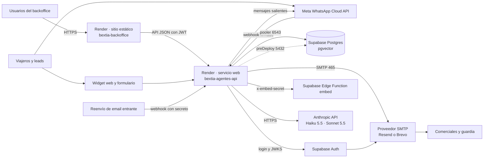
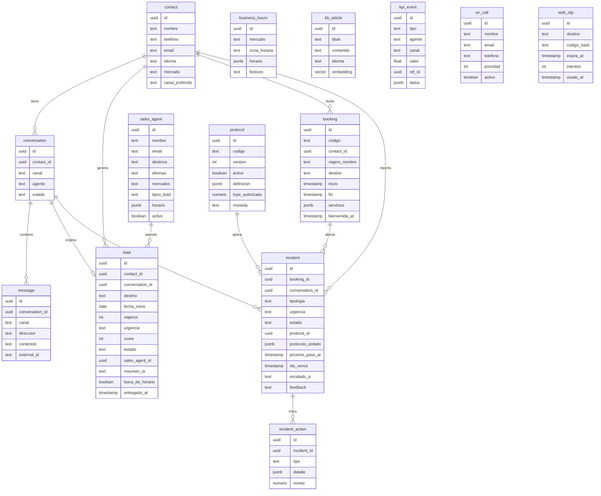
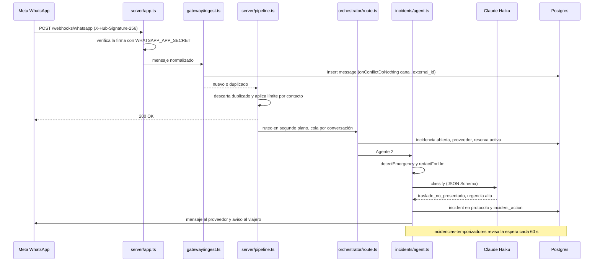

# 03 · Arquitectura detallada y plan de deployment

Componentes desplegables, modelo de datos, flujo de un mensaje y plan por entornos. La definición de infraestructura está en `bextia-agentes/render.yaml`; los pasos concretos, en [06 · Instrucciones de despliegue](./06-instrucciones-despliegue.md).

## Componentes

| Componente | Proveedor | Definición | Función |
|---|---|---|---|
| Servicio web `bextia-agentes-api` | Render (runtime Node 24, plan `starter`, región Frankfurt) | `render.yaml` | API Hono: webhooks de canales, widget, importación, API del backoffice, agentes y temporizadores. Health check en `/api/health`. Arranque con `yarn workspace @bextia/agents start`. |
| Migraciones (preDeploy) | Render | `render.yaml`, `apps/agents/src/db/migrate.ts` | `yarn workspace @bextia/agents db:migrate:deploy` aplica las migraciones de `apps/agents/drizzle/` antes de cada versión, por la conexión directa (`DATABASE_URL_DIRECT`, puerto 5432). |
| Temporizadores en proceso | Dentro del servicio web | `apps/agents/src/server/scheduler.ts`, `apps/agents/src/main.ts` | Entrega de leads cada 15 minutos; protocolo, SLA e inactividad cada 60 segundos. No hay cron de Render. |
| Sitio estático `bextia-backoffice` | Render | `render.yaml` | Backoffice compilado con Vite (`apps/backoffice/dist`), reescritura `/*` → `/index.html`, cabeceras CSP y `X-Frame-Options: DENY`. |
| Postgres con pgvector | Supabase | `apps/agents/drizzle/`, `api/src/db/schema.ts` | Datos de contactos, conversaciones, leads, reservas, incidencias, protocolos, base de conocimiento y KPI. La API se conecta por el pooler (puerto 6543). |
| Auth | Supabase | `apps/agents/src/api/auth.ts`, `apps/agents/src/auth/jwt.ts` | Login del backoffice con email y contraseña a través de la API; el JWT lleva el rol en `app_metadata.role`. |
| RLS | Supabase | `supabase/rls/0001_rls.sql` | Políticas por rol para accesos directos con la clave publicable. |
| Edge Function `embed` | Supabase | `supabase/functions/embed/index.ts` | Embeddings gte-small (384 dimensiones) para la base de conocimiento, protegida con `x-embed-secret`. |

Supabase Storage no se usa: los CSV de reservas llegan en el cuerpo de la petición y no se guardan como archivo.

## Diagrama de despliegue

## Modelo de datos

Tablas reales del esquema Drizzle (`api/src/db/schema.ts`, reexportado por `apps/agents/src/db/schema.ts`). Se muestran las columnas principales.

Restricciones relevantes:

- `message_canal_external_id`: único sobre (canal, external_id); es la base de la idempotencia.
- `conversation_abierta_unica`: una sola conversación abierta por contacto y canal.
- `incident_abierta_por_conversacion`: una sola incidencia abierta por conversación.
- `protocol_codigo_version`: un protocolo por código y versión.
- `kb_article.embedding` es `vector(384)`.

## Flujo de un webhook

Mensaje de WhatsApp de un viajero con reserva activa que avisa de un traslado no presentado.

## Plan de deployment

| Entorno | Base de datos | Configuración | Uso |
|---|---|---|---|
| Local | Postgres de un proyecto Supabase de desarrollo (o una instancia local de Postgres con pgvector) vía `DATABASE_URL` | `.env` en `bextia-agentes/` con `SIMULATOR_ENABLED=true`; `yarn workspace @bextia/agents dev` y `yarn workspace @bextia/backoffice dev` | Desarrollo y demo con el simulador. Los tests usan PGlite en memoria (`apps/agents/src/db/test-db.ts`) y no necesitan base de datos. |
| Staging | Proyecto Supabase separado | Copia del Blueprint con otros nombres de servicio, `SIMULATOR_ENABLED=true` y `VITE_API_URL` y CSP apuntando a la API de staging | Validación del cliente (UAT) con el simulador y, si se aprueba, un número de WhatsApp de prueba. |
| Producción | Proyecto Supabase de producción | `render.yaml` tal cual (`SIMULATOR_ENABLED=false`, `NODE_ENV=production`) | Operación real. |

Secuencia de promoción:

1. En `bextia-agentes/`, sin errores: `yarn test` y `yarn typecheck` (cubren `@bextia/agents`), `yarn workspace @bextia/backoffice test` y `yarn workspace @bextia/backoffice typecheck`.
2. Despliegue manual en staging (`autoDeploy: false`): el preDeploy aplica las migraciones y Render espera a que `/api/health` responda.
3. Prueba de humo con el simulador: un lead fuera de horario y un traslado no presentado.
4. Aprobación de BEXTIA y despliegue manual del mismo commit en producción.

Nada se crea ni se despliega en Render o Supabase sin la aprobación del dueño de la cuenta.

## Rollback

- **Código.** En Render, volver al deploy anterior del servicio web y del sitio estático desde el historial de deploys. Con `autoDeploy: false` ningún push despliega por sí solo.
- **Base de datos.** Las migraciones de `apps/agents/drizzle/` solo avanzan; no hay migraciones de bajada. Antes de una migración que cambie columnas existentes se toma una copia de seguridad en Supabase. Si hay que deshacer, se escribe una migración compensatoria nueva o se restaura la copia.
- **Compatibilidad.** Las migraciones aditivas (tablas o columnas nuevas) permiten volver al código anterior sin tocar la base.
- **Temporizadores.** Al volver a una versión anterior, los temporizadores se reanudan solos con el proceso. Los pasos de protocolo vencidos se procesan en la siguiente vuelta de 60 segundos.
- **Configuración.** Los cambios de variables de entorno en Render se revierten editando el valor y redesplegando; los secretos generados por Render (`generateValue`) no se regeneran en un rollback.
