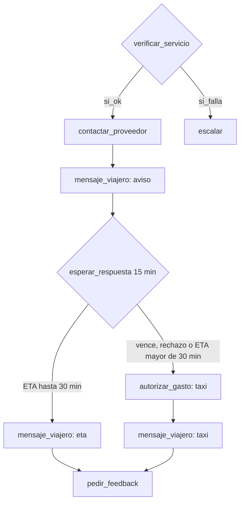

# 05 · Código y componentes

Mapa del código de `bextia-agentes/`, prompts, formato de los protocolos y tareas periódicas. Todas las rutas son relativas a `bextia-agentes/`.

## Árbol del monorepo

Monorepo yarn 1 con workspaces `api` y `apps/*`, Node 24 y módulos ESM.

```text
bextia-agentes/
├── api/                    API base generada con Jor-El desde el contrato (handlers CRUD y esquema Drizzle)
│   └── src/db/schema.ts    esquema único de tablas, enumerados e índices
├── apps/
│   ├── agents/             servicio web @bextia/agents: canales, agentes, API del backoffice y temporizadores
│   │   ├── drizzle/        migraciones SQL (0000_enable_vector a 0004_backoffice)
│   │   └── src/            código del servicio (módulos en la tabla siguiente)
│   └── backoffice/         panel @bextia/backoffice con Vite, React 19 y Lara Fluent
│       └── src/            App, Shell, pages/ y lib/
├── contract/               jor.json (contrato de datos) y scripts de generación
├── supabase/
│   ├── functions/embed/    Edge Function de embeddings gte-small (384)
│   └── rls/                políticas RLS por rol
├── knowledge_base/         decisiones, objeciones y lecciones del proyecto
├── discovery/              material de descubrimiento (correo del cliente, reuniones, ajustes)
├── demos/                  demos funcionales con datos de prueba
├── assets/                 recursos gráficos
├── docs/                   documentos de alcance del cliente
├── render.yaml             Blueprint de Render (servicio web y sitio estático)
├── .env.example            variables de entorno documentadas
└── package.json            workspaces y scripts test, typecheck y contract
```

## Módulos del servicio `apps/agents/src/`

| Ruta | Responsabilidad | Tests |
|---|---|---|
| `main.ts`, `env.ts` | Arranque: lectura y validación del entorno, canales activos, cliente de Claude, límites de tasa y temporizadores. | `env.test.ts` |
| `server/` | Aplicación Hono y rutas (`app.ts`), pipeline de mensajes (`pipeline.ts`), límites de tasa, `startInterval` (`scheduler.ts`) y rutas del widget. | 5 |
| `channels/` | Adaptadores WhatsApp, JSON (email, formulario y simulador) y web; firma y comparación en tiempo constante. | 3 |
| `gateway/` | Ingesta idempotente: alta de contacto y conversación, inserción del mensaje por (canal, external_id). | 1 |
| `orchestrator/` | Ruteo entre agentes y cálculo de horario comercial con zona horaria y festivos. | 2 |
| `leads/` | Agente 1: conversación, cualificación, scoring, asignación, entrega y máquina de estados. | 6 |
| `incidents/` | Agente 2: identificación, clasificación, redacción de datos personales, respuesta del proveedor, protocolo, SLA, escalado y máquina de estados. | 8 |
| `protocols/` | Tipos, parser, motor (máximo 20 pasos por vuelta), render de plantillas y siembra del protocolo. | 3 |
| `llm/` | Cliente de Anthropic (`anthropic.ts`), LLM con respuestas grabadas para tests (`scripted.ts`), LLM no disponible y `MODELS`. | 1 |
| `rag/` | Cliente de la Edge Function de embeddings, búsqueda en pgvector y CLI de indexado (`kb:index`). | 2 |
| `notify/` | SMTP con nodemailer y detección de errores transitorios. | 1 |
| `api/` | API del backoffice: auth, leads, incidencias, configuración, importación, KPI, export CSV y simulador. | 8 |
| `auth/` | Verificación del JWT de Supabase por JWKS y control por rol. | 1 |
| `widget/` | OTP por email o WhatsApp y token firmado del widget web. | 2 |
| `db/` | Conexión (postgres-js en ejecución, PGlite en tests), migrador de deploy y reexport del esquema. | 3 |
| `e2e/` | Recorridos completos con el simulador: lead fuera de horario y traslado no presentado. | 2 |
| `eval/` | Evaluación de prompts con casos sintéticos y puntuación (ver [anexo](./anexos/eval-prompts.md)). | 1 |

El backoffice (`apps/backoffice/src/`) tiene tests en `lib/` para cliente HTTP, sesión, roles, enlaces, formatos, KPI y diferencias del CRUD.

Comandos: `yarn workspace @bextia/agents test`, `yarn workspace @bextia/agents typecheck`, `yarn workspace @bextia/backoffice test` y `yarn workspace @bextia/backoffice typecheck`.

## Prompts del sistema

Los textos viven en el código; aquí se enlazan, no se copian. Las salidas de `classify` usan `output_config` con JSON Schema (máximo 2048 tokens) y se validan con Clark; `converse` devuelve texto (máximo 1024 tokens). Ver `apps/agents/src/llm/anthropic.ts`.

| Prompt | Archivo | Propósito | Modelo | Salida |
|---|---|---|---|---|
| Conversación del lead | [`leads/prompts.ts`](https://github.com/jpirela/bextia-agentes/blob/main/apps/agents/src/leads/prompts.ts) (`buildConversationSystem`) | Responder fuera de horario, pedir los datos que faltan y usar los artículos de la base. | Sonnet 5.5 | Texto libre. |
| Cualificación | [`leads/qualify.ts`](https://github.com/jpirela/bextia-agentes/blob/main/apps/agents/src/leads/qualify.ts) (`extractQualification`) | Extraer los datos del lead de la transcripción. | Haiku 5.5 | `QUALIFICATION_SCHEMA`: destino, fecha_inicio, fecha_fin, viajeros, interes, urgencia, tipo, idioma, nombre, email, telefono y pregunta, todos anulables. |
| Resumen del lead | [`leads/qualify.ts`](https://github.com/jpirela/bextia-agentes/blob/main/apps/agents/src/leads/qualify.ts) (`summarizeLead`) | Resumen para el comercial. | Haiku 5.5 | `{ resumen }`. |
| Clasificación de incidencia | [`incidents/classify.ts`](https://github.com/jpirela/bextia-agentes/blob/main/apps/agents/src/incidents/classify.ts) (`classifyIncident`) | Tipología, urgencia y señales sobre el historial redactado. | Haiku 5.5 | `{ tipologia, urgencia, emocional, impacto_economico_alto, idioma, resumen }` con enumerados cerrados y resumen de hasta 300 caracteres. |
| Respuesta del proveedor | [`incidents/provider.ts`](https://github.com/jpirela/bextia-agentes/blob/main/apps/agents/src/incidents/provider.ts) (`parseProviderReply`) | Interpretar ETA o rechazo cuando las expresiones regulares no bastan. | Haiku 5.5 | `{ tipo: eta \| rechazo \| desconocido, minutos }`. |
| Consulta del viajero | [`incidents/prompts.ts`](https://github.com/jpirela/bextia-agentes/blob/main/apps/agents/src/incidents/prompts.ts) (`buildIncidentSystem`) | Responder con los artículos de la base en el idioma del viajero. | Sonnet 5.5 | Texto libre. |
| Textos fijos | [`incidents/prompts.ts`](https://github.com/jpirela/bextia-agentes/blob/main/apps/agents/src/incidents/prompts.ts), [`leads/prompts.ts`](https://github.com/jpirela/bextia-agentes/blob/main/apps/agents/src/leads/prompts.ts) | Identificación, emergencia, escalado, error temporal, bienvenida, agradecimiento y mensaje no soportado. | Sin LLM | Texto fijo. |

## Formato de los protocolos

Un protocolo es un JSON con `codigo`, `nombre`, `inicio` (paso inicial), `pasos` y `plantillas`. Los tipos de paso (`apps/agents/src/protocols/types.ts`) son:

| Tipo | Campos | Efecto |
|---|---|---|
| `verificar_servicio` | `si_ok`, `si_falla` | Comprueba que la reserva tiene el servicio afectado. |
| `contactar_proveedor` | `plantilla`, `siguiente` | Envía el mensaje al proveedor por simulador, WhatsApp o email. |
| `mensaje_viajero` | `plantilla`, `siguiente` | Envía un mensaje al viajero. |
| `esperar_respuesta` | `minutos`, `max_eta_min`, `si_responde`, `si_vence` | Programa `proximo_paso_at` y espera la respuesta del proveedor. |
| `autorizar_gasto` | `concepto`, `siguiente` | Registra la autorización hasta el `tope_autorizado` del protocolo. |
| `pedir_feedback` | `plantilla` | Pasa la incidencia a `seguimiento`. |
| `escalar` | `motivo` | Escala a la guardia. |

Las plantillas admiten los marcadores `{{viajero}}`, `{{codigo}}`, `{{proveedor}}`, `{{lugar}}`, `{{hora}}`, `{{referencia}}`, `{{eta}}`, `{{monto}}` y `{{moneda}}`. El tope y la moneda no están en el JSON: se guardan en la tabla `protocol` al sembrarlo con `yarn workspace @bextia/agents protocol:seed <tope> <moneda>` (con una base remota exige `ALLOW_REMOTE_SEED=1`).

Ejemplo real, copiado de `apps/agents/src/protocols/definitions/traslado-no-presentado.json`:

```json
{
  "codigo": "traslado_no_presentado",
  "nombre": "Traslado no presentado",
  "inicio": "verificar",
  "pasos": {
    "verificar": { "tipo": "verificar_servicio", "si_ok": "contactar", "si_falla": "escalar" },
    "contactar": { "tipo": "contactar_proveedor", "plantilla": "proveedor", "siguiente": "avisar" },
    "avisar": { "tipo": "mensaje_viajero", "plantilla": "aviso", "siguiente": "esperar" },
    "esperar": { "tipo": "esperar_respuesta", "minutos": 15, "max_eta_min": 30, "si_responde": "confirmar_eta", "si_vence": "autorizar" },
    "confirmar_eta": { "tipo": "mensaje_viajero", "plantilla": "eta", "siguiente": "feedback" },
    "autorizar": { "tipo": "autorizar_gasto", "concepto": "taxi", "siguiente": "confirmar_taxi" },
    "confirmar_taxi": { "tipo": "mensaje_viajero", "plantilla": "taxi", "siguiente": "feedback" },
    "feedback": { "tipo": "pedir_feedback", "plantilla": "feedback" },
    "escalar": { "tipo": "escalar", "motivo": "servicio_no_verificable" }
  },
  "plantillas": {
    "proveedor": "Hola {{proveedor}}: el viajero del servicio {{referencia}} espera su traslado en {{lugar}} ({{hora}} UTC) y no lo encuentra. ¿En cuántos minutos llegan? Respondan solo con los minutos, por favor.",
    "aviso": "{{viajero}}, ya estamos contactando a {{proveedor}}. Te escribimos en un máximo de 15 minutos.",
    "eta": "Buenas noticias: {{proveedor}} llega en unos {{eta}} minutos a {{lugar}}.",
    "taxi": "{{proveedor}} no confirmó a tiempo. Toma un taxi oficial hasta tu hotel: te reembolsamos hasta {{monto}} {{moneda}}. Guarda el recibo.",
    "feedback": "Cuando estés en el hotel, cuéntanos en una frase cómo fue todo."
  }
}
```



## Temporizadores

No hay workflows ni cron externos. El servicio web registra cuatro tareas con `startInterval(fn, ms, nombre)` (`apps/agents/src/server/scheduler.ts`), que no solapa ejecuciones y no impide que el proceso termine (`unref`). Se registran en `apps/agents/src/main.ts`.

| Nombre | Intervalo | Función |
|---|---|---|
| `entrega-leads` | 15 minutos | `deliverDue` (`leads/delivery.ts`) |
| `incidencias-temporizadores` | 60 segundos | `runDueTimers` (`incidents/sla.ts`) |
| `incidencias-sla` | 60 segundos | `escalateOverdue` (`incidents/sla.ts`) |
| `incidencias-inactividad` | 60 segundos | `closeStale` (`incidents/sla.ts`) |

Valen para una sola instancia; con varias habría ejecuciones duplicadas (P17, P32).

## Scripts de mantenimiento

| Script | Comando | Uso |
|---|---|---|
| Migraciones en desarrollo | `yarn workspace @bextia/agents db:migrate` | drizzle-kit contra `DATABASE_URL`. |
| Migraciones en deploy | `yarn workspace @bextia/agents db:migrate:deploy` | preDeploy de Render, con `DATABASE_URL_DIRECT`. |
| Generar migración | `yarn workspace @bextia/agents db:generate` | Tras cambiar el esquema. |
| Sembrar protocolo | `yarn workspace @bextia/agents protocol:seed <tope> <moneda>` | Alta o nueva versión del protocolo. |
| Indexar base de conocimiento | `yarn workspace @bextia/agents kb:index` | Calcula los embeddings pendientes; requiere `DATABASE_URL`, `SUPABASE_URL` y `EMBED_SECRET`. |
| Evaluar prompts | `yarn workspace @bextia/agents eval` | Llama a Claude real y cuesta dinero: requiere aprobación y `EVAL_CONFIRM=si`. |
