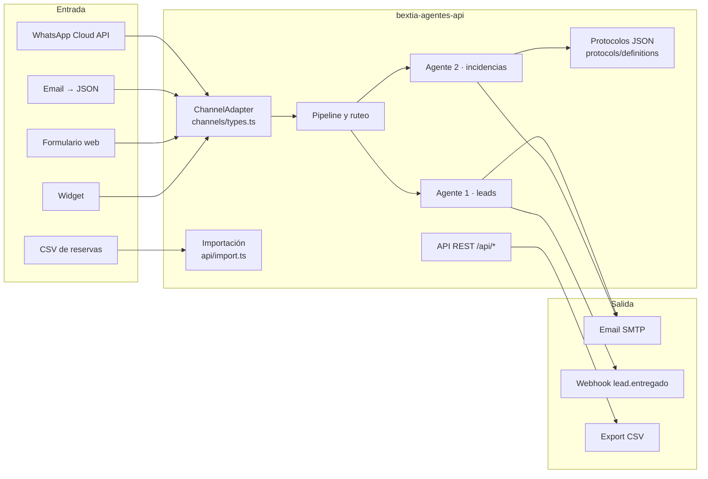

# 10 · Integraciones

Integraciones que el prototipo ya trae y las que se pueden agregar, con su punto de extensión en el código (rutas relativas a `bextia-agentes/apps/agents/src/`) y un esfuerzo estimado en horas. Las estimaciones suponen el sistema actual estable y no incluyen el trámite con el tercero (cuentas, contratos, certificación). Tarifa de referencia en la [propuesta económica (1b)](../propuesta/1b-propuesta-economica.md).

## Puntos de extensión

1. **Adaptador de canal** (`channels/types.ts`): interfaz `ChannelAdapter` con `receive(req)` (convierte la petición del tercero en `InboundMessage[]`) y `send(msg)`. Un canal nuevo implementa esa interfaz, agrega su nombre al tipo `Channel` (columna de texto, sin migración) y se registra en el mapa `channels` de `main.ts`. El resto del pipeline (identificación de contacto, ruteo, agentes, KPI) no cambia.
2. **Webhook saliente** (`leads/delivery.ts`): cada lead entregado se envía por `POST` a `LEADS_WEBHOOK_URL` con el evento `lead.entregado` y la firma `x-bextia-signature: sha256=<HMAC>`.
3. **Importación** (`api/import.ts`): CSV o JSON `{ rows }` con el contrato de columnas de [08](./08-requerimientos-implantacion.md#9-csv-de-reservas).
4. **Protocolos JSON** (`protocols/definitions/`): pasos de una lista cerrada (`protocols/types.ts`) que el motor ejecuta sin código nuevo ([05](./05-codigo-y-componentes.md#formato-de-los-protocolos)).
5. **API REST** (`api/index.ts`): rutas `/api/*` con JWT de Supabase; base para que otro sistema lea leads, incidencias o KPI.

## Integraciones existentes

| Integración | Dirección | Ruta y autenticación | Código | Estado |
|---|---|---|---|---|
| WhatsApp Cloud API | Entrada y salida | `POST /webhooks/whatsapp` con `x-hub-signature-256` (HMAC con `WHATSAPP_APP_SECRET`); `GET /webhooks/whatsapp` para el reto de verificación | `channels/whatsapp.ts` | Construida; solo texto |
| Email entrante | Entrada | `POST /webhooks/email` con `x-webhook-secret` (`EMAIL_WEBHOOK_SECRET`) | `channels/json-channel.ts` | Construida; falta la pasarela que convierte el correo en JSON (≈ 8 h con el «inbound parse» del proveedor de email) |
| Formulario web | Entrada | `POST /webhooks/form` con `x-webhook-secret` (`FORM_WEBHOOK_SECRET`), enviado desde el servidor del sitio | `channels/json-channel.ts` | Construida; conectar el formulario ≈ 4 h |
| Widget web | Entrada y salida | `/widget/*`: OTP de 6 dígitos (10 min, 5 intentos) y token HMAC de 12 h (`WIDGET_TOKEN_SECRET`); dominio en `CORS_ORIGINS` | `channels/web.ts`, `widget/` | Construida; incrustar en el sitio ≈ 4 h |
| Email saliente (SMTP) | Salida | Credenciales `SMTP_*` | `notify/mailer.ts` | Construida |
| Webhook de leads | Salida | `POST` a `LEADS_WEBHOOK_URL`, firma `x-bextia-signature`, timeout 5 s; un fallo registra el KPI `webhook_fallido` | `leads/delivery.ts` | Construida; sin marca de tiempo en la firma (P24) |
| Importación de reservas | Entrada | Panel `POST /api/import/bookings` (rol `admin`); `POST /import/bookings` con `Authorization: Bearer <IMPORT_TOKEN>`; `POST /import/email` con `x-import-secret` (`IMPORT_EMAIL_SECRET`). Sin token o secreto configurado, la ruta responde 404 | `api/import.ts`, `api/csv.ts` | Construida |
| Export CSV de leads | Salida | `GET /api/export/leads.csv` (rol `admin`); 30 días por omisión, máximo 731 días y 50.000 filas; celdas protegidas contra fórmulas | `api/export.ts`, `api/csv.ts` | Construida |
| API REST | Entrada y salida | `/api/health` y `/api/auth/login` públicas; el resto con JWT de Supabase (ES256/RS256, `aud` `authenticated`, `iss` y `exp` obligatorios) y rol en `app_metadata.role` | `api/index.ts`, `auth/jwt.ts`, `auth/roles.ts` | Construida |
| Base de conocimiento | Interna | Edge Function `embed` de Supabase con `x-embed-secret` (`EMBED_SECRET`) | `rag/` y, en la raíz del monorepo, `supabase/functions/embed/` | Construida; despliegue en implantación |

### Payload del webhook de leads

Cuerpo JSON (`leads/delivery.ts`): `event` (`lead.entregado`) y un objeto `lead` con `id`, `destino`, `fecha_inicio`, `fecha_fin`, `viajeros`, `interes`, `urgencia`, `tipo`, `score`, `resumen_ia`, `mercado`, `idioma` y `sales_agent_email`. El receptor verifica la firma calculando el HMAC SHA-256 del cuerpo con `LEADS_WEBHOOK_SECRET` y comparándolo en tiempo constante.

## Integraciones posibles

| Integración | Para qué | Punto de extensión | Esfuerzo |
|---|---|---|---|
| CRM (HubSpot, Pipedrive, Salesforce) | Crear el lead u oportunidad al entregarlo | Webhook saliente `lead.entregado` hacia un conector del CRM o un automatizador; firma con marca de tiempo (P24) | 16 h con automatizador; 32 h con conector directo |
| Estado de venta de vuelta desde el CRM | Medir conversión y leads recuperados ([11](./11-operacion-mantenimiento.md#mapeo-con-los-kpi-del-alcance)) | Ruta nueva en `api/` autenticada con secreto, que actualice el lead | 16 h |
| Sistema de reservas propio | Alta automática de reservas sin CSV manual | `POST /import/bookings` con `IMPORT_TOKEN` y JSON `{ rows }` | 8 h si exporta JSON o CSV; 24 h si hay que leer su API |
| PMS hotelero | Contexto del alojamiento en incidencias (check-in, habitación) | Campos nuevos en la reserva + importación; protocolo JSON que los use | 40 h |
| GDS (Amadeus, Sabre) | Estado de vuelos para retrasos y conexiones | Conector nuevo consultado por un paso de protocolo; requiere ampliar la lista de tipos de paso (`protocols/types.ts`) | 60 h, más la certificación del GDS |
| Telefonía (Twilio Voice u otro) | Llamadas entrantes y avisos de voz a la guardia | `ChannelAdapter` nuevo con transcripción; aviso de voz en `incidents/escalate.ts` | 48 h |
| Canales de mensajería adicionales (Telegram, Instagram) | Más vías de entrada | `ChannelAdapter` nuevo | 16 h por canal |
| Nueva tipología de incidencia | Otro protocolo accionable | Archivo JSON en `protocols/definitions/` + casos de evaluación | 16 h si usa tipos de paso existentes; 32 h si necesita uno nuevo |
| Plantillas de WhatsApp | Escribir fuera de la ventana de 24 h (P39) | `send` de `channels/whatsapp.ts` con `type: template` | 8 h, más la aprobación de Meta |

Las integraciones que suman datos personales (PMS, GDS, CRM) deben revisarse contra el [plan de seguridad (14)](./14-plan-seguridad.md#rgpd) antes de construirse.
