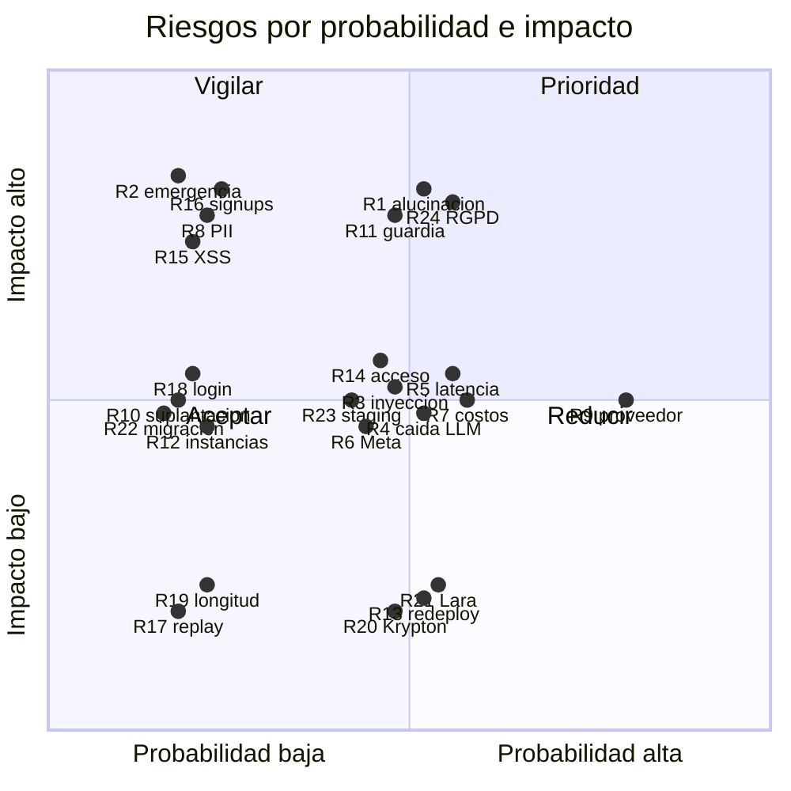

# 12 · Riesgos

Matriz de riesgos del sistema en producción. Probabilidad e impacto en tres niveles: **B** (bajo), **M** (medio), **A** (alto). Los dueños son roles: **Operaciones** y **Comercial** (BEXTIA), **TI** (BEXTIA, a cargo de cuentas y secretos) e **Implantador** (equipo de desarrollo durante la implantación y el soporte). Las limitaciones de las que parten estos riesgos están en [09](./09-limitaciones.md).

## Matriz

| # | Riesgo | Prob. | Impacto | Mitigación | Dueño |
|---|---|---|---|---|---|
| R1 | **Alucinación o clasificación errónea**: el LLM inventa un dato o asigna mal la tipología | M | A | Salida en JSON Schema validada con Clark; el LLM no fija montos ni ejecuta acciones; si la clasificación falla o es crítica, emocional, de alto impacto económico o no contemplada, `decideRoute` escala a la guardia; evaluación 30/30 ([13](./13-plan-testing.md#evaluación-de-prompts)); revisión semanal de una muestra ([11](./11-operacion-mantenimiento.md#rutinas)) | Operaciones |
| R2 | **Emergencia no detectada**: un mensaje de riesgo físico no se escala | B | A | `detectEmergency` corre antes del LLM y escala de inmediato; queda abierta la vía de un número sin reserva (P41) | Implantador |
| R3 | **Inyección de prompt**: un mensaje intenta cambiar las instrucciones del agente | M | M | El LLM no tiene herramientas; los pasos del protocolo son una lista cerrada; el tope solo lo cambia un `admin`; la salida estructurada se valida antes de usarla ([14](./14-plan-seguridad.md#guardarraíles-del-llm)) | Implantador |
| R4 | **Caída o lentitud de Anthropic** | M | M | Timeout de 20 s y 2 reintentos; si falla, respuesta de respaldo y evento `fallback_llm`; las incidencias siguen escalando por SLA | TI |
| R5 | **Respuesta por encima de 30 s** (RNF-01): 20 s × hasta 3 intentos, más embedding, puede superar el objetivo (P22, peor caso ~2 min) | M | M | Caso típico muy por debajo; presupuesto total por turno pendiente; medir con `respuesta_enviada` cuando se corrija P73 | Implantador |
| R6 | **Límites de la API de Meta**: ventana de 24 h, calidad del número, límites de envío | M | M | Respuesta inmediata dentro de la ventana; plantilla aprobada pendiente (P39); email como canal alternativo | TI |
| R7 | **Costos de LLM por volumen** o por abuso (mensajes en masa, OTP a destinos arbitrarios) | M | M | 20 mensajes por minuto por contacto y 120 por IP; Haiku para clasificar y Sonnet solo para conversar; límite de gasto en la consola de Anthropic; revisión mensual ([11](./11-operacion-mantenimiento.md#mensual-administrador-y-ti-3-h)) | TI |
| R8 | **Fuga de PII** a logs, al LLM o por exportaciones | B | A | Logs de error solo con nombre y código; redacción antes del LLM en el Agente 2; export solo `admin` con protección anti-fórmulas; RLS; purga RGPD pendiente (P57) | TI |
| R9 | **Proveedor que no responde** al protocolo de traslado | A | M | Espera de 15 min; si no confirma ETA ≤ 30 min, autoriza taxi hasta el tope; SLA y escalado a la guardia | Operaciones |
| R10 | **Proveedor suplantado** (P33) o respuesta asignada a otra incidencia (P37) | B | M | Ventana de 7 días; solo incidencias activas; con ambigüedad, escala | Implantador |
| R11 | **Guardia sin cobertura**: escalado sin nadie que lo reciba | M | A | Aviso a la guardia activa de menor prioridad; evento `aviso_guardia_fallido`; rutina diaria de comprobación | Operaciones |
| R12 | **Más de una instancia** activada por error: emails y temporizadores duplicados (P2, P17, P21, P29, P32) | B | M | Plan `starter` con una instancia; `claimWait` evita dobles pasos de protocolo; antes de escalar, cron o `pg_advisory_lock` ([11](./11-operacion-mantenimiento.md#escalado-de-la-infraestructura)) | Implantador |
| R13 | **Redeploy con trabajo en curso**: se pierde el mensaje en despacho (P5) y los leads pendientes esperan hasta 15 min (P20) | M | B | `autoDeploy: false`; desplegar en horas valle | Implantador |
| R14 | **Acceso residual** tras una baja: token válido hasta ~1 h (P66) o comercial desactivado con rol (P67) | M | M | La baja es quitar el rol; bajar la expiración del JWT a 10–15 min | TI |
| R15 | **Robo de sesión por XSS** en el backoffice (P45) | B | A | CSP estricta, `X-Frame-Options: DENY`, React escapa el contenido | Implantador |
| R16 | **Reclamo del email de un comercial** con registros públicos activos (P68) | B | A | Registros públicos desactivados como precondición del despliegue ([06](./06-instrucciones-despliegue.md#paso-6-proyecto-supabase-auth-y-roles)) | TI |
| R17 | **Repetición del webhook de leads** capturado (P24) | B | B | HTTPS y secreto compartido; firmar con marca de tiempo cuando haya receptor real | Implantador |
| R18 | **Ataque de fuerza bruta al login** con contadores en memoria (P44) | B | M | 5 fallos por email e IP en 15 min; 120 peticiones por minuto por IP en `/api/auth/*` | Implantador |
| R19 | **Longitud del secreto observable** por tiempo de comparación (P8) | B | B | Aceptado: los secretos son de longitud fija | Implantador |
| R20 | **Dependencia de Krypton** (K1–K4): regenerar con Jor-El revierte cambios o no termina | M | B | El servicio en ejecución no depende de Krypton; `render.yaml` y handlers mantenidos a mano; driver `postgres` fijado a `^4.1.0` ([07](./07-herramientas-terceros.md#ecosistema-krypton)) | Implantador |
| R21 | **Actualización de Lara** que rompe pantallas (P60) | M | B | Versión fijada; adaptadores probados (`crud-diff.ts`); revisar al actualizar | Implantador |
| R22 | **Migración bloqueada** por datos duplicados (P23) | B | M | Consulta previa en el runbook ([06](./06-instrucciones-despliegue.md#paso-5-migraciones)); rollback documentado ([03](./03-arquitectura-deployment.md#rollback)) | Implantador |
| R23 | **Cambios sin staging** que llegan a producción con defectos | M | M | Suites de test, simulador, despliegue manual y rollback; staging pendiente | Implantador |
| R24 | **Incumplimiento RGPD** por falta de retención y supresión (P57) | M | A | Minimización de PII; borrado manual por SQL ante una solicitud; job de purga pendiente | TI |

## Probabilidad × impacto

Escala: B = 0,2 · M = 0,5 · A = 0,8, con un pequeño desplazamiento para que los puntos no se superpongan.

## Prioridades antes de producción

1. **R24 y R8**: definir el plazo de retención y el procedimiento de supresión (P57).
2. **R1 y R11**: guardia cubierta en todo horario de viaje y revisión semanal de clasificaciones desde la primera semana.
3. **R16 y R14**: registros públicos desactivados y expiración del JWT en 10–15 min (P66, P68).
4. **R5**: presupuesto total por turno y corrección del KPI de primera respuesta (P22, P73).
5. **R6 y R7**: plantilla de WhatsApp aprobada y límite de gasto mensual en Anthropic.
