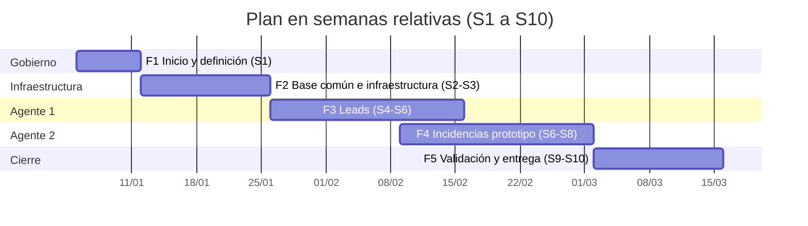

# 1a · Plan de proyecto con horas y tiempo

Respuesta al punto 1a del correo de BEXTIA: plan simple, con horas de esfuerzo y tiempo, para desplegar la infraestructura Cloud y desarrollar e implantar los dos Agentes IA del alcance. Es la fuente única de horas: el [presupuesto (1b)](./1b-propuesta-economica.md) y los entregables [02](../entregables/02-propuesta-tecnica.md) y [03](../entregables/03-arquitectura-deployment.md) enlazan estas cifras, no las copian.

## 1. Resumen

- **5 fases** del alcance de BEXTIA (Inicio, Base común, Agente 1, Agente 2 prototipo, Cierre).
- **Esfuerzo total: 224–318 horas.**
- **Duración estimada: 7–10 semanas** con una dedicación de 35 h/semana (224 h son 6,4 semanas de trabajo efectivo y 318 h son 9,1; con holguras de coordinación y revisión, 7 y 10).
- Arquitectura propuesta: monorepo Node 24 + TypeScript con un **servicio web** (API y agentes) y un **sitio estático** (panel de backoffice) en Render, base de datos y autenticación en Supabase (Postgres, pgvector, Auth, Edge Function de embeddings) y modelos Claude por API (clasificación con Haiku, conversación con Sonnet). Detalle en [03](../entregables/03-arquitectura-deployment.md).
- La estimación se apoya en un prototipo funcional ya construido de esa arquitectura (agentes de leads e incidencias, simulador de canales y backoffice), por lo que el riesgo de esfuerzo es bajo en F2–F4; el rango alto cubre integración con los canales reales del cliente (Meta, SMTP) y el ajuste de reglas.

## 2. Fases y horas

| Fase | Contenido | Horas | Entregables del alcance |
|---|---|---|---|
| F1 Inicio, definición y gobierno | Kick-off, requisitos por agente, criterios de aceptación, plan de seguridad | 16–24 | 01, 14 |
| F2 Base común e infraestructura | Contrato de datos, gateway de canales, simulador, Supabase, Render | 40–56 | 02, 03, 06, 07, 08 |
| F3 Agente 1 — Leads | Cualificación, scoring, asignación, entrega, horario | 80–110 | 05 (A1), 13 (A1) |
| F4 Agente 2 — Incidencias (prototipo) | Identificación, clasificación, protocolo traslado no presentado, escalado | 56–80 | 05 (A2), 13 (A2) |
| F5 Validación final, cierre y entrega | Evaluación de prompts, matriz de testing, manual, documentación | 32–48 | 04, 09, 10, 11, 12, 13 |
| **Total** | | **224–318** | |

Los números de entregable corresponden a los documentos de `docs/entregables/` (01 documentación técnica, 02 propuesta técnica, 03 arquitectura y deployment, 04 manual de operación, 05 código y componentes, 06 instrucciones de despliegue, 07 herramientas de terceros, 08 requerimientos de implantación, 09 limitaciones, 10 integraciones, 11 operación y mantenimiento, 12 riesgos, 13 plan de testing, 14 plan de seguridad).

## 3. Diagrama de Gantt

Escenario alto (318 h, 10 semanas). F3 y F4 se solapan una semana (S6). Las fechas son ilustrativas: lo relevante son las semanas relativas S1–S10.

## 4. Hitos y criterios de aceptación

| Fase | Hito | Criterio de aceptación verificable |
|---|---|---|
| F1 | Definición aprobada | Requisitos por agente y criterios de aceptación firmados por BEXTIA; plan de seguridad (14) entregado |
| F2 | Plataforma operativa | Servicio web responde en `/api/health` desplegado en Render; migraciones aplicadas en Supabase; un mensaje enviado desde el simulador atraviesa el gateway y queda registrado como conversación |
| F3 | Agente 1 funcional | Un lead fuera de horario recibe respuesta automática, queda cualificado con puntuación y asignado a un comercial por destino e idioma, y llega el email de entrega con resumen; el tiempo de primera respuesta se mide con el KPI `respuesta_enviada` (objetivo < 30 s; ver P22 en [09](../entregables/09-limitaciones.md): el peor caso con reintentos aún lo supera) |
| F4 | Prototipo del Agente 2 | Un viajero con reserva activa reporta un traslado no presentado y el protocolo contacta al proveedor, gestiona su ETA o rechazo, registra la autorización de gasto hasta el tope y escala a una persona cuando corresponde; el estado y las acciones quedan trazados |
| F5 | Cierre y entrega | Suites de pruebas unitarias e integración ejecutadas y reportadas en la matriz de testing (13); evaluación de prompts con casos sintéticos documentada; manual de operación (04) y documentación (01–14) entregados |

## 5. Supuestos

- El cliente provee la **app de Meta** (WhatsApp Cloud API), un **SMTP** (Resend o Brevo), el **CSV de reservas** y el listado de **comerciales** con su especialidad, idioma y horario.
- **Sin integración nativa con el CRM** del cliente (el alcance lo excluye por falta de credenciales): el lead se registra en la base propia y se entrega por email y, opcionalmente, por webhook firmado.
- Un único mercado y zona horaria por defecto (variable `DEFAULT_MARKET`); nuevos mercados son configuración, no desarrollo.
- Una sola tipología de incidencia accionable (traslado no presentado); otras tipologías reciben respuesta conversacional o se escalan, como pide el alcance.
- BEXTIA valida con UAT en cada hito en un plazo de 2 días laborables; los retrasos de validación mueven las fechas, no las horas.
- Datos de prueba sintéticos; ningún dato personal real en desarrollo ni en evaluación.
